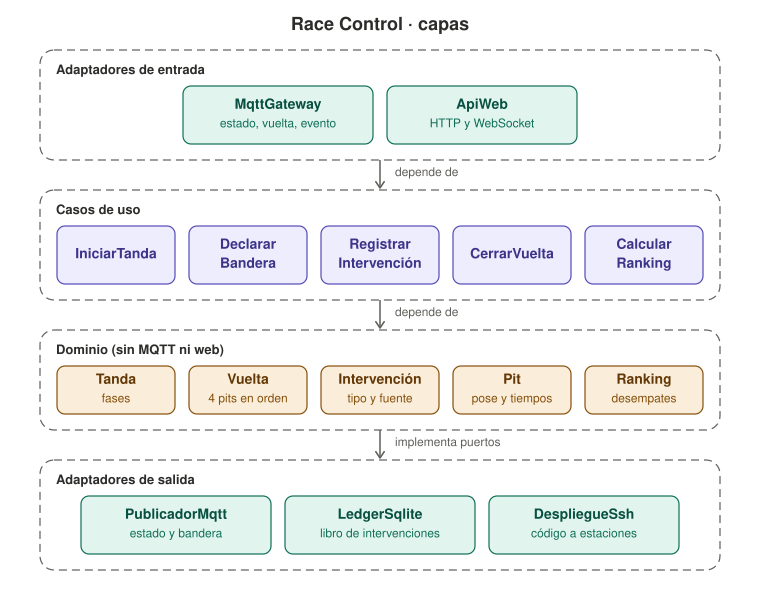

# PC-Race · Arquitectura de Race Control

Programa del curso, en Python 3.12, en un solo proceso asyncio. Arbitra la carrera: no mueve robots.

## Capas



Las dependencias apuntan al dominio. El dominio no conoce MQTT, HTTP ni SQLite.

## Estructura de carpetas

```
pc-race/
  pyproject.toml
  src/pc_race/
    dominio/            tanda.py, vuelta.py, intervencion.py, pit.py, ranking.py, bandera.py
    aplicacion/
      casos_de_uso/     iniciar_tanda.py, declarar_bandera.py, registrar_intervencion.py,
                        cerrar_vuelta.py, calcular_ranking.py
      puertos.py        interfaces que usa la aplicación
    adaptadores/
      entrada/          mqtt_gateway.py, api_web.py
      salida/           publicador_mqtt.py, ledger_sqlite.py, despliegue_ssh.py, reloj.py
    configuracion.py
    main.py             arma todo y arranca
  contrato/             modelos pydantic del contrato MQTT
  tests/
```

## Dominio

| Concepto | Regla |
|---|---|
| `Tanda` | 4 vueltas, máximo 12 min; fases: calentamiento (3 min), carrera, bandera roja, fin |
| `Vuelta` | válida si el carrito pasó por las 4 estaciones en orden y cada pit tiene `resultado` ok |
| `Intervencion` | tipos: física, web, teleoperación, software. No cuentan: pulsar Iniciar, mirar el tablero, ajustes antes del inicio, pausa del juez, bandera roja |
| `Intervencion` no declarada | si el juez la ve en el video, suma +3 |
| `Ranking` | menos intervenciones; empate: más vueltas válidas, menor tiempo medio de vuelta, menor error medio de pose en los pits |
| Elegible | al menos 3 vueltas válidas |

## Puertos y adaptadores

| Puerto | Adaptador | Librería |
|---|---|---|
| `RepositorioIntervenciones` | `LedgerSqlite` | `aiosqlite` |
| `PublicadorEstado` | `PublicadorMqtt` | `aiomqtt` |
| `Reloj` | `RelojSistema` (NTP lo da el sistema) | `chrony` en el sistema operativo |
| `DespliegueEstaciones` | `DespliegueSsh` | `asyncssh` |
| Entrada de mensajes | `MqttGateway` | `aiomqtt`, validación con `pydantic` v2 |
| Entrada web | `ApiWeb` | `FastAPI` y `uvicorn`, WebSocket para el tablero |

La máquina de estados de la tanda usa la librería `transitions`, no código propio.

## Casos de uso

| Caso de uso | Disparado por | Efecto |
|---|---|---|
| `IniciarTanda` | juez, API | pasa a calentamiento o carrera y publica `carrera/estado` |
| `DeclararBandera` | juez, API | publica `carrera/bandera`; la roja no cuenta como intervención |
| `RegistrarIntervencion` | evento del carrito o del juez | guarda en el ledger y actualiza el ranking |
| `CerrarVuelta` | mensaje `vuelta` | valida contra los `resultado` de las estaciones |
| `CalcularRanking` | cada cambio | publica el ranking al tablero |

## Fallos y qué hace

| Fallo | Respuesta |
|---|---|
| Estación sin latido 3 s | la marca `OFFLINE` y avisa al juez; la tanda de ese equipo se repite si fue falla del curso |
| Carrito `OFFLINE` | el reloj de la tanda sigue; el juez decide |
| Reinicio de Race Control | reconstruye la tanda desde el ledger y vuelve a publicar los estados retenidos |
| Broker caído | reintenta con espera creciente; no pierde lo ya guardado |
| Mensaje inválido | se descarta, se cuenta y se muestra en el panel |

## Pruebas

- **Dominio:** pytest sin broker ni red; las reglas de ranking y de vuelta válida llevan casos de empate.
- **Contrato:** cada ejemplo de `00-contrato-mqtt.md` se valida contra los modelos pydantic.
- **Integración:** Mosquitto local y un script `simulador_carritos.py` que lanza 10 carritos falsos.
- **Calidad:** `ruff` y `mypy` en cada commit.

## Orden de desarrollo

1. Dominio y pruebas (sin red).
2. Ledger SQLite y casos de uso.
3. `MqttGateway` y `PublicadorMqtt` con el simulador de carritos.
4. `ApiWeb` y tablero del juez.
5. `DespliegueSsh` y prueba con una estación real. Diseño y puntos abiertos en [04-despliegue-ssh.md](04-despliegue-ssh.md).
