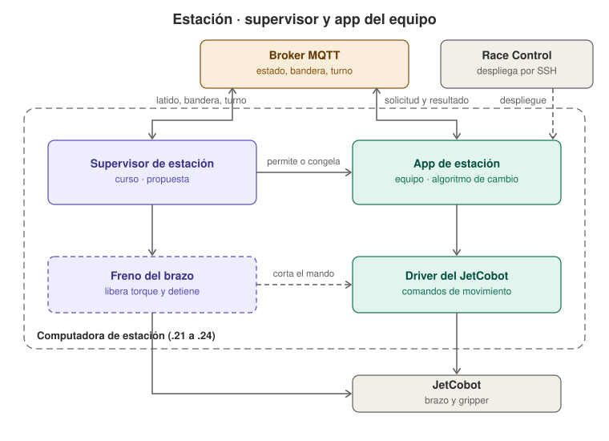

# JetCobot · Arquitectura de la estación

Corre en la computadora de la estación (.21 a .24). Dos programas con dueños distintos.

## Componentes



| Componente | Dueño | Responsabilidad |
|---|---|---|
| `supervisor_estacion` | Curso | Habla con Race Control y el carrito, valida cada solicitud, congela el brazo |
| `app_equipo` | Equipo | Decide cómo hacer el cambio de pieza a partir de la pose |
| `BrazoJetCobot` (puerto) | Curso | Interfaz única al brazo: mover, abrir y cerrar gripper, soltar torque |

El equipo nunca habla con el brazo ni con el broker directamente: solo implementa la estrategia.

## Estructura de carpetas

```
estacion/
  supervisor/src/supervisor_estacion/
    dominio/            estado_estacion.py, validacion_solicitud.py
    aplicacion/         atender_solicitud.py, congelar_brazo.py
    adaptadores/        mqtt_estacion.py, brazo_jetcobot.py
  plantilla_equipo/src/app_equipo/
    estrategia.py       aquí programa el equipo
    brazo_simulado.py   para probar sin hardware
```

## Lo que programa el equipo

```python
class EstrategiaDeCambio(Protocol):
    def cambiar(self, pose: PoseDock, pieza_trae: Pieza | None) -> ResultadoCambio: ...
```

- `PoseDock`: `dx`, `dy` en metros y `dth` en grados, medidos por el carrito.
- `ResultadoCambio`: `ok`, `pieza_dejo`, `t_cambio`, `error` opcional.
- Solo puede usar el objeto `brazo` que recibe (puerto `BrazoJetCobot`).

## Estados del supervisor

| Estado | Entra cuando | Sale cuando |
|---|---|---|
| `LIBRE` | no hay turno de equipo | Race Control asigna el turno |
| `ESPERANDO` | hay turno y la estación está lista | llega una `solicitud` válida |
| `CAMBIANDO` | solicitud aceptada | la estrategia termina o vence el tiempo |
| `LISTA` | `resultado` publicado | el carrito se aleja y vuelve a `LIBRE` o `ESPERANDO` |
| `OFFLINE` | broker perdido (Last Will) | el broker vuelve |

## Validación de una solicitud

Se rechaza con motivo en el `resultado` si falla cualquiera:

1. La estación no está en `ESPERANDO`.
2. El `equipo` no es el que tiene el turno.
3. La pose sale de tolerancia (≤4 cm y ≤6° como base).
4. Hay bandera roja.

Rechazar no cuenta como intervención; el carrito reintenta hasta 2 veces.

## Seguridad del brazo

| Situación | Acción |
|---|---|
| Bandera roja | congela el brazo y suelta torque |
| Sin broker más de 3 s | congela el brazo |
| La estrategia excede el tiempo máximo del cambio (parámetro, base a definir) | corta el mando y publica `ok: false` |
| Excepción en `app_equipo` | captura, congela y publica el error |

Congelar es acción del supervisor, nunca de la app del equipo.

## Despliegue

Race Control copia el código del equipo a `/opt/granprix/app_equipo` por SSH en el cambio de tanda y reinicia el servicio `app-equipo` con systemd. El supervisor no se reemplaza.

## Herramientas

`estacion/herramientas/herramienta_apriltag.py` crea y detecta AprilTags. Es de laboratorio: no es parte del supervisor ni del flujo de la carrera, y no toca el brazo. La decisión D3 sigue igual (el brazo no usa cámara y la pose del carrito la mide el carrito).

| Comando | Qué hace |
|---|---|
| `crear --id 3 --tamano-mm 60` | Escribe el tag en PNG y en SVG a tamaño real para imprimir al 100 % |
| `detectar --camara 0` | Lee de cámara, o de `--imagen` o `--video`, y escribe una línea JSON por tag |
| `detectar ... --tamano-mm 60 --fov-h 70` | Además da la pose: `x`, `y`, `z` en metros y `dth` en grados |
| `autoprueba` | Crea tags, los pone en una imagen y comprueba que se leen con el mismo id |

Familias: `tag36h11` (por defecto), `tag25h9` y `tag16h5`. La pose necesita el lado real del tag impreso y la cámara; con `--fov-h` es una aproximación sin distorsión, y con `--fx --fy --cx --cy` de una calibración sale mejor. Dependencias en `estacion/herramientas/requirements.txt`. Imágenes de ejemplo, con la entrada y la salida de cada comando, en `estacion/herramientas/ejemplos/README.md`.

## Pruebas

- **Estrategia:** con `brazo_simulado.py`, sin hardware ni broker.
- **Supervisor:** pytest con un broker local y un carrito falso que envía solicitudes válidas e inválidas.
- **Hardware:** prueba de alcance con un cubo antes de la carrera (ver mesa de pit en el reto).

## Por confirmar

Cómo se controla el JetCobot desde esta computadora (librería, puerto, latencia). Eso solo cambia el adaptador `brazo_jetcobot.py`.
