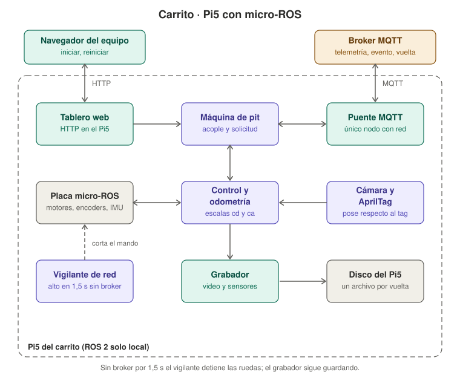

# MicroROS-Pi5 · Arquitectura del carrito

Corre en el Pi5 de cada carrito. El curso entrega una plantilla; el equipo programa el control y el pit.

## Componentes



| Nodo | Dueño | Responsabilidad | Hacia dónde |
|---|---|---|---|
| `placa_micro_ros` | Yahboom | Motores, encoders, IMU | `/odom`, `/imu`, `/cmd_vel` |
| `control_odometria` | Equipo | Seguir la ruta y calcular las escalas `cd` y `ca` | `/cmd_vel` |
| `camara_apriltag` | Equipo (base del curso) | Medir la pose respecto al tag de la pared | `/tag/pose` |
| `maquina_pit` | Equipo | Acople fino, solicitud a la estación, reset de pose | `/pit/estado` |
| `puente_mqtt` | Curso | Único nodo con red; traduce ROS 2 y MQTT | `/granprix/estado`, `/granprix/enlace` |
| `vigilante_red` | Curso | Detiene las ruedas si no hay broker por 1,5 s | `/cmd_vel_vigilante` |
| `tablero_web` | Curso (el equipo extiende) | Iniciar, reiniciar, declarar intervención | `/granprix/orden` |
| `grabador` | Curso | Video y sensores de cada vuelta | disco |

## Estructura de carpetas

```
ws/src/
  granprix_msgs/            mensajes y servicios propios
  granprix_carrito/
    control_odometria/      equipo
    camara_apriltag/        equipo
    maquina_pit/            equipo
    puente_mqtt/            curso
    vigilante_red/          curso
    tablero_web/            curso
    grabador/               curso
  launch/carrito.launch.py
```

## Interfaces internas

| Tópico ROS 2 | Tipo | Frecuencia |
|---|---|---|
| `/odom` | `nav_msgs/Odometry` | 20 Hz |
| `/tag/pose` | `geometry_msgs/PoseStamped` | al ver el tag |
| `/cmd_vel` | `geometry_msgs/Twist` | 20 Hz |
| `/granprix/estado` | estado de carrera (propio) | al cambiar |
| `/granprix/enlace` | `std_msgs/Bool` | 2 Hz |

El mando de ruedas pasa por `twist_mux`: el vigilante tiene prioridad máxima y manda cero si el enlace se pierde.

## Secuencia de un pit

1. `camara_apriltag` mide la pose del carrito contra el tag.
2. `maquina_pit` corrige hasta quedar a ≤4 cm y ≤6° (máximo 2 reintentos).
3. Se publica la `solicitud` por `puente_mqtt` con la pose.
4. Espera `resultado`; si es `ok`, mide otra vez.
5. `control_odometria` aplica el reset de pose y actualiza `cd` y `ca` con filtro exponencial.
6. El carrito sale hacia la siguiente estación.

Objetivo de tiempo del pit: ≤10 s.

## Evidencia

El `grabador` guarda por cada vuelta:

| Dato | Formato |
|---|---|
| Video de la cámara del carrito | MP4 |
| Odometría, IMU, pose del tag, escalas | rosbag2 |
| Eventos de pit | CSV |

Un archivo por vuelta, con el número de vuelta en el nombre. No depende de la red.

## Variables de entorno

| Variable | Valor |
|---|---|
| `ROS_DOMAIN_ID` | número del equipo |
| `ROS_LOCALHOST_ONLY` | `1` |
| `GRANPRIX_BROKER` | `192.168.50.10` |
| `GRANPRIX_EQUIPO` | número del equipo |

## Librerías

`twist_mux`, `apriltag_ros` o `pupil-apriltags`, `rosbag2`, `aiomqtt`, `FastAPI`. No se escribe a mano lo que ya existe.

## Pruebas

- **Sin hardware:** un simulador de carrito publica `/odom` y `/tag/pose` con ruido para probar la máquina de pit.
- **Con Race Control:** el carrito se conecta al PC-Race de pruebas y completa una vuelta falsa.
- **Pérdida de red:** apagar el broker durante una vuelta; el vigilante debe detener las ruedas en 1,5 s.

## Por confirmar

- Distribución ROS 2 de la imagen del MicroROS-Pi5.
- Funciones exactas de la placa micro-ROS.
- Enfoque de la cámara a unos 28 cm del tag.
