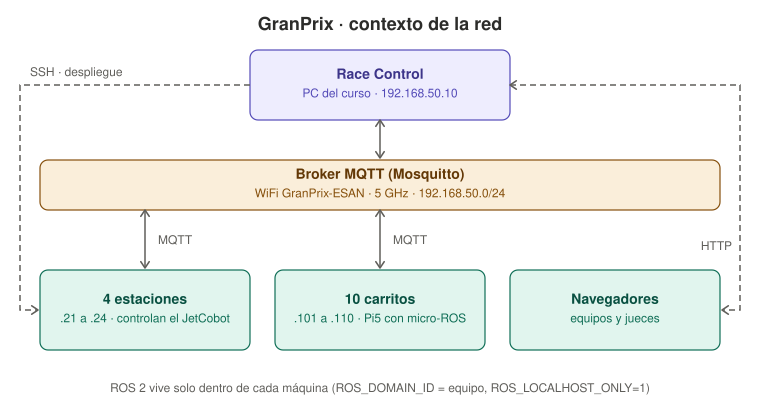

# GranPrix Delivery Semiautónomo · Arquitectura de software

Documentos de arquitectura de los tres desarrollos. Cada uno se implementa en su propio repositorio o carpeta.

| Documento | Desarrollo | Quién lo programa | Lenguaje |
|---|---|---|---|
| [00-contrato-mqtt.md](00-contrato-mqtt.md) | Contrato entre las tres partes | Curso | JSON sobre MQTT |
| [01-pc-race.md](01-pc-race.md) | Race Control (PC del curso) | Curso | Python 3.12 |
| [02-jetcobot-estacion.md](02-jetcobot-estacion.md) | Estación con JetCobot | Curso (supervisor) y equipo (app) | Python |
| [03-microros-pi5-carrito.md](03-microros-pi5-carrito.md) | Carrito MicroROS-Pi5 | Equipo (sobre plantilla del curso) | Python, ROS 2 |
| [04-despliegue-ssh.md](04-despliegue-ssh.md) | Despliegue del código del equipo a las estaciones (paso 5 de Race Control) | Curso | Python (`asyncssh`) |

## Vista general

## Reglas que valen para los tres

- ROS 2 vive solo dentro de cada máquina (`ROS_LOCALHOST_ONLY=1`, `ROS_DOMAIN_ID` = número de equipo). Entre máquinas solo hay MQTT, HTTP y SSH.
- Una sola fuente de verdad por dato: el estado de la carrera es de Race Control; la pose del carrito es del carrito; el estado del brazo es de la estación.
- El dominio no importa MQTT, HTTP, ROS ni SQLite. Esos son adaptadores.
- Nombres del lenguaje del reto: `Tanda`, `Vuelta`, `Intervencion`, `Pit`, `Dock`, `Bandera`. Nada de `utils`, `helpers` ni `common`.
- Todo mensaje lleva versión (`v`) y hora (`ts`, segundos Unix, NTP sincronizado).

## Decisiones tomadas

| # | Decisión | Motivo |
|---|---|---|
| D1 | MQTT (Mosquitto) entre máquinas, ROS 2 solo local | Un broker simple; ROS 2 en WiFi con 15 máquinas es frágil |
| D2 | Race Control no manda movimientos a brazos ni carritos | El algoritmo es del equipo; el curso solo arbitra |
| D3 | El carrito mide y reporta su pose; el brazo no usa cámara | Menos hardware; el pit es el mismo que se evalúa |
| D4 | Supervisor del curso separado de la app del equipo | Un error del equipo no deja el brazo sin freno |
| D5 | Python asyncio en Race Control | Un proceso, sin hilos, fácil de probar |
| D6 | Ledger en SQLite | Sobrevive a un reinicio y se exporta a CSV |

## Por confirmar con el hardware real

- Cómo se maneja el JetCobot desde la estación (librería, puerto, latencia).
- Distribución ROS 2 que trae la imagen del MicroROS-Pi5.
- Latencia de `solicitud` a `resultado` con 10 carritos en el WiFi.
- Quién asigna el turno de cada estación (`granprix/estacion/<n>/turno`) y cómo se despliega el código de varios equipos en 4 estaciones. Ver [04-despliegue-ssh.md](04-despliegue-ssh.md).
