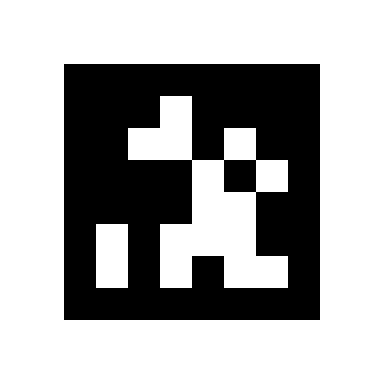
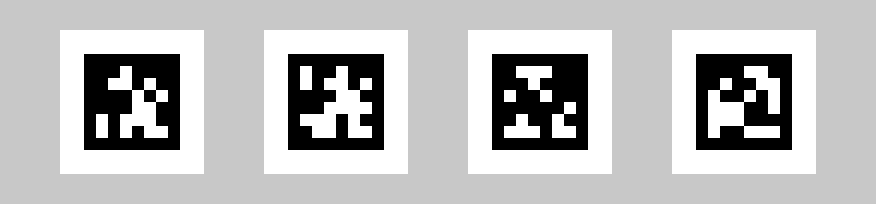
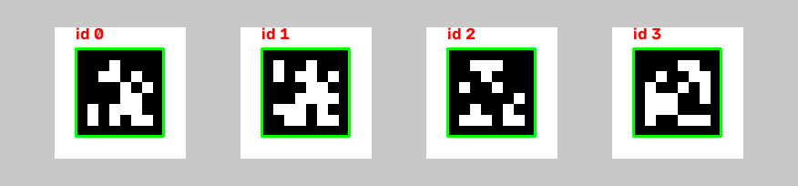
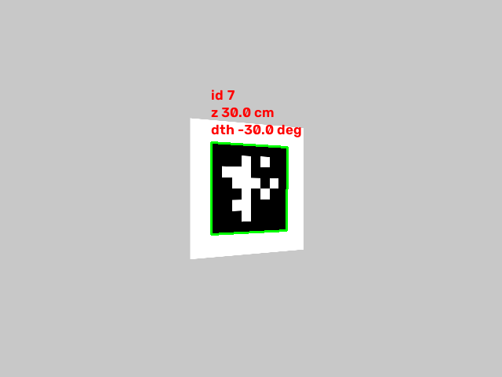
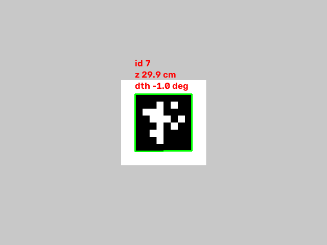
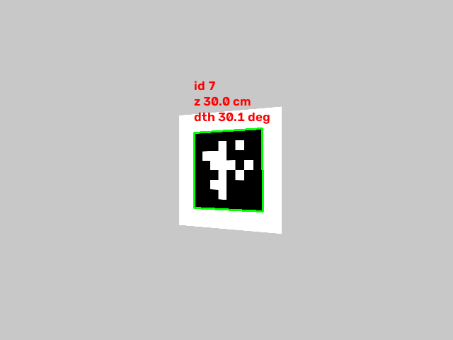

# Ejemplos de AprilTag

Imágenes para probar `herramienta_apriltag.py`. Todas son **sintéticas**: las dibuja el propio script, no son fotos de una cámara. Sirven para ver el formato de entrada y de salida, y para comprobar que la herramienta funciona antes de conectar el JetCobot.

## Tags para imprimir

Carpeta [tags/](tags/): ids 0 a 3 de la familia `tag36h11`, en PNG y en SVG.



- El **SVG** tiene tamaño real: este está hecho para un cuadrado negro de **60 mm**. Imprímelo al 100 % (sin "ajustar a la página") y mide con regla.
- El **PNG** sirve para pantalla o para probar el detector. No lo uses para imprimir a escala.
- El margen blanco alrededor es parte del tag: sin él el detector no lo ve.

```
python herramienta_apriltag.py crear --id 0-3 --tamano-mm 60 --salida ejemplos/tags
```

## Varios tags en una imagen

| Entrada | Resultado |
|---|---|
|  |  |

```
python herramienta_apriltag.py detectar --imagen ejemplos/escena_varios.png --anotada resultado.png
```

Sin datos de la cámara solo da el id, el centro y las esquinas de cada tag.

## Pose: tag de frente y girado

Un tag de 60 mm a 30 cm de una cámara de 640×480 con 60° de campo de visión horizontal. El tag está girado alrededor del eje vertical.

| `giro_menos30` | `giro_0` | `giro_mas30` |
|---|---|---|
|  |  |  |
| `dth` ≈ −30° | `dth` ≈ 0° | `dth` ≈ +30° |

```
python herramienta_apriltag.py detectar --imagen ejemplos/giro_mas30.png --tamano-mm 60 --fov-h 60
```

Salida (una línea JSON; aquí partida para leerla):

```
{"cuadro": 1, "id": 7, "centro": [320.55, 240.23],
 "esquinas": [[370.88, 181.97], [274.89, 187.6], [274.88, 293.11], [371.21, 298.63]],
 "margen": 119.0, "hamming": 0,
 "pose": {"x": 0.0003, "y": 0.0002, "z": 0.3001, "dth": 30.1, "error": 8.1e-09}}
```

`x`, `y`, `z` en metros respecto a la cámara (x a la derecha, y hacia abajo, z hacia adelante). `dth` en grados, giro alrededor del eje vertical de la cámara. Los tres ejemplos valen `z` = 0,300 m.

Las imágenes `giro_*` están hechas con `render_con_giro` de `test_herramienta_apriltag.py`, que proyecta el tag con una cámara ideal sin distorsión. Con una cámara real las cifras serán menos exactas: calibra y usa `--fx --fy --cx --cy`.
